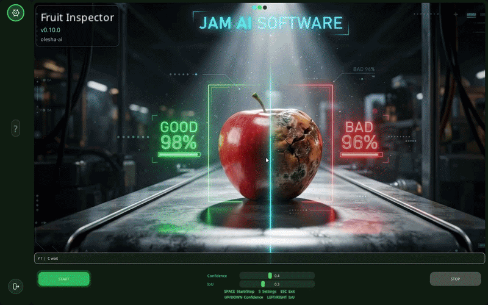
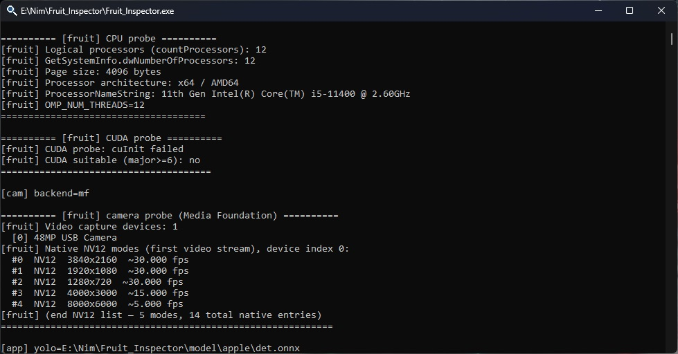
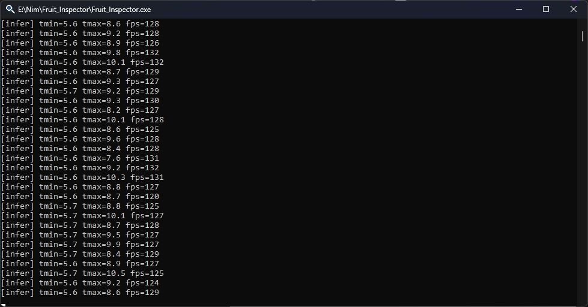

# Fruit Inspector

**Build 0.11.0 (Win + Linux x64)** · Nim · ONNX Runtime (Win: cpu / openvino / directml; Linux: cpu / openvino / cuda) · conveyor station demo (eval)

Fruit Inspector is **conveyor inspection**: fruit on a belt; quality is graded only in the **control zone** (centre cell **C**), not anywhere in the frame.

- **This repo:** runnable **Windows and Linux demos** (ImGui shell + three inference libraries). No Nim product source on `main`.
- **Same three inference DLLs for your own UI:** [fruit-inspector-engine](https://github.com/olesha-ai/fruit-inspector-engine) · [HOST.md](https://github.com/olesha-ai/fruit-inspector-engine/blob/main/HOST.md)

## Download

| File | Use |
|------|-----|
| **[Fruit_Inspector_DLL.7z](https://github.com/olesha-ai/fruit-inspector-demo/releases/download/0.11.0/Fruit_Inspector_DLL.7z)** | **Windows (0.11.0):** `Fruit_Inspector.exe`, **`trig.exe`**, three fruit DLLs, **`lib/cpu/`**, **`lib/openvino/`**, **`lib/directml/`** + MSVC, apple models. Default `ort_provider` = `cpu`. **Use this on Win64.** |
| **[Fruit_Inspector_linux_x64.zip](https://github.com/olesha-ai/fruit-inspector-demo/releases/download/0.11.0/Fruit_Inspector_linux_x64.zip)** | **Linux x64 (0.11.0):** app, three `.so`, models, **`lib/cpu/`**, **`lib/openvino/`**, `lib/linux/`, `run.sh`. Debian 12/13, Ubuntu 22.04+. |
| **[Fruit_Inspector_linux_x64_cuda.zip](https://github.com/olesha-ai/fruit-inspector-demo/releases/download/0.11.0/Fruit_Inspector_linux_x64_cuda.zip)** | **Linux CUDA add-on (0.11.0):** unpack into the **same folder** as above → `lib/cuda/`. Needs NVIDIA driver; set `ort_provider` = `cuda`, `ort_lib_dir` = `lib/cuda`. |
| [Fruit_Inspector_linux_app_x64.zip (0.10.0)](https://github.com/olesha-ai/fruit-inspector-demo/releases/download/0.10.0/Fruit_Inspector_linux_app_x64.zip) | **Legacy Linux:** single zip, CPU ORT in `lib/linux/` only. |
| [Fruit_Inspector_DLL.7z (0.10.0)](https://github.com/olesha-ai/fruit-inspector-demo/releases/download/0.10.0/Fruit_Inspector_DLL.7z) | Previous Windows pack: **`lib/cpu/` only**. |

Releases: [0.11.0](https://github.com/olesha-ai/fruit-inspector-demo/releases/tag/0.11.0) · [0.10.0](https://github.com/olesha-ai/fruit-inspector-demo/releases/tag/0.10.0)

Windows: unpack with [7-Zip](https://www.7-zip.org/) or similar. Linux: unzip **both** 0.11.0 archives into **one** `Fruit_Inspector_linux_x64/` folder if you need CUDA. Use a local folder, not a network drive.

---

## What is on `main`

- [README.md](README.md), [LICENSE.md](LICENSE.md), [licenses/](licenses/)
- Demo media: `infer.gif`, `processor.jpg`, `speed.jpg`
- Binaries live in **[Releases](https://github.com/olesha-ai/fruit-inspector-demo/releases)** only

## Contents of `Fruit_Inspector_DLL.7z`

- `Fruit_Inspector.exe` — UI, 3×3 grid, conveyor focus/sticky, Windows camera (NV12)
- **`trig.exe`** — TCP client for **`GOOD <id>` / `BAD <id>`** from the inspector (see **trig**)
- `fruit_infer.dll`, `fruit_cat.dll`, `fruit_features.dll` — ONNX Runtime inference; the exe is a **shell** (no in-process ORT)
- `lib/cpu/` — `onnxruntime.dll`, `onnxruntime_providers_shared.dll`, plus **MSVC CRT** (`MSVCP140*`, `VCRUNTIME140*`) so you do not install VC++ Redist separately
- `libgcc_s_seh-1.dll`, `libstdc++-6.dll`, `libwinpthread-1.dll` — MinGW runtime for the Nim binaries
- `model/apple/` — `det.onnx`, `cat.onnx`, `features.json` (apple pack only)
- `settings.json`, `LICENSE.md`, `licenses/` (keep the whole folder)

**ORT (0.11.0 Windows):** `lib/cpu/`, `lib/openvino/`, `lib/directml/` in the archive. Switch with `"ort_provider"` in `settings.json` or Settings in the exe (no rebuild). `lib/cuda/` optional if you add it locally.

Default `"ort_provider": "cpu"`. Win CPU EP expects **AVX2** on x64.

**Product mode:** conveyor **station** (cell **C**); pan-tilt / neck tracking is **off** in this build (`NeckTrackingEnabled = false` in the shipped product).

## Contents of Linux 0.11.0 (`Fruit_Inspector_linux_x64.zip` + optional `*_cuda.zip`)

- `Fruit_Inspector` — main app (ext4 / home disk); `Fruit_Inspector.exe` name for FAT USB
- `fruit_infer.so`, `fruit_cat.so`, `fruit_features.so`
- `lib/cpu/`, `lib/openvino/`, `lib/linux/` — ONNX Runtime (switch `ort_lib_dir` / provider in `settings.json`)
- `lib/cuda/` — from the **second zip** only (CUDA EP + bundled GPU libs)
- `model/apple/`, `settings.json`, `licenses/`
- `run.sh`, `install_to_home.sh`, `Fruit_Inspector.desktop` — launch (**`bash run.sh`** on USB; see `README.txt` in zip)

**CPU:** x86_64, SSE4.2 + AVX1 (this drop). **CUDA:** discrete NVIDIA (e.g. GTX 1650 Ti class), driver for CUDA 12.

**Not offered here yet:**

- ARM demo
- Sample host app (C#, Lazarus, …) — see the engine repo
- Factory PLC chain (stop belt → ready → grade) — direction only, not shipped
- Other crops — apple only unless added later

---

## Pictures







**Test bench:** Intel i5-11400, 32 GB RAM, no discrete GPU, USB camera 1920×1080.

**Speed (that bench, CPU EP):** Station path: YOLO on control cell **C** (640) plus ROI refine **256**, then features + Cat. Console `[infer]` fps depends on that dual path and pre/post — often well above live preview. Live camera preview is about **30 fps** (camera limit, not infer). `speed.jpg` may show an older setup; trust `[infer]` when you run from cmd.

---

## Idea

- 3×3 grid; **C** = control zone
- Up to two apples on the line; stable IDs; focus on nearest to C; sticky after leave C
- Cat (LightGBM) only when the focus apple centre is inside C
- Pipeline: YOLOX on **C** (640) → ROI 256 → 44 features → Cat → **GOOD / BAD** on screen and on Out TCP

---

## Station behaviour

- No full-frame chase — work in **C** with an ID queue
- Approaching C: detect and track only
- In C: features and verdict
- Left C: sticky handoff to the next ID

---

## Architecture (0.11.0)

```
Camera (NV12) → Fruit_Inspector (UI + conveyor)
                      ↓
              fruit_infer (.dll / .so) (YOLO)
                      ↓
              RGB crop on host
                      ↓
              fruit_features → fruit_cat
                      ↓
              Out TCP  "GOOD|BAD <id>"  →  trig.exe (LAN display / integration)
```

---

## trig

**Included in the Windows demo archive.** Desktop client that connects to the inspector over TCP (host/port from `settings.json`: `ip_addr`, `ip_port`). After auth, it shows **`GOOD <apple id>`** and **`BAD <apple id>`** — English only, no coordinates, no turret FIRE.

Use it on a second PC or beside the line to prove the **Out** contract without writing your own host. Full factory story (stop section → ready → grade) is future work; on the desk, Cat runs when the focus apple is in **C**.

---

## Stack

- Nim, ImGui (GLFW); camera: Windows Media Foundation or Linux V4L2 → NV12
- Windows 0.11.0: ONNX Runtime **cpu / openvino / directml** in the archive
- Linux 0.11.0: **cpu / openvino / cuda** (cuda via second zip)
- `settings.json`: provider, models, camera, threads, Out bind — edit by hand or Settings → Apply

---

## Run (Windows)

1. Download [Fruit_Inspector_DLL.7z](https://github.com/olesha-ai/fruit-inspector-demo/releases/download/0.11.0/Fruit_Inspector_DLL.7z) and unpack.
2. One tree: `Fruit_Inspector.exe`, **`trig.exe`**, three fruit DLLs, MinGW DLLs next to exe, `lib/cpu/`, `lib/openvino/`, `lib/directml/`, `model/apple/`, `settings.json`, `licenses/`.
3. Set `camera_index` and `ort_provider` (`cpu` first).
4. From cmd: `Fruit_Inspector.exe` for `[infer]` fps on stdout.
5. UI: START / STOP; Esc confirms quit.
6. **trig:** start `trig.exe`, connect to the inspector IP/port (same machine: loopback + port from `settings.json`).

## Run (Linux 0.11.0)

1. Download [Fruit_Inspector_linux_x64.zip](https://github.com/olesha-ai/fruit-inspector-demo/releases/download/0.11.0/Fruit_Inspector_linux_x64.zip) and unzip to e.g. `~/Fruit_Inspector_linux_x64/`.
2. For **CUDA:** also download [Fruit_Inspector_linux_x64_cuda.zip](https://github.com/olesha-ai/fruit-inspector-demo/releases/download/0.11.0/Fruit_Inspector_linux_x64_cuda.zip) and unpack into the **same** folder (creates `lib/cuda/`).
3. `bash ~/Fruit_Inspector_linux_x64/run.sh`
4. Install once: GL/Mesa/X11 libs, `v4l-utils`; user in group `video` for USB camera; NVIDIA driver for cuda EP.
5. EP: `settings.json` — e.g. `ort_provider`: `cpu` | `openvino` | `cuda`; for openvino/cuda set `ort_lib_dir` to `lib/openvino` or `lib/cuda`.
6. On FAT USB: use `.desktop`, `Fruit_Inspector.exe`, or `run.sh` (see zip `README.txt`).
7. Logs under `logs/`.

## Run (Linux 0.10.0 legacy)

1. Download [Fruit_Inspector_linux_app_x64.zip](https://github.com/olesha-ai/fruit-inspector-demo/releases/download/0.10.0/Fruit_Inspector_linux_app_x64.zip) and unzip.
2. `bash /path/to/Fruit_Inspector_linux_app_x64/run.sh`

---

## License

Testing, teaching, research, and feedback — yes. Commercial production under this license — no.

[LICENSE.md](LICENSE.md), [licenses/Fruit_Inspector_LICENSE.md](licenses/Fruit_Inspector_LICENSE.md), [licenses/THIRD_PARTY.md](licenses/THIRD_PARTY.md). Keep `licenses/` next to the exe.

Commercial inquiries: olesha-ai.

Intel, OpenVINO, Microsoft, Megvii, and other names are trademarks of their respective owners.

---

olesha-ai
