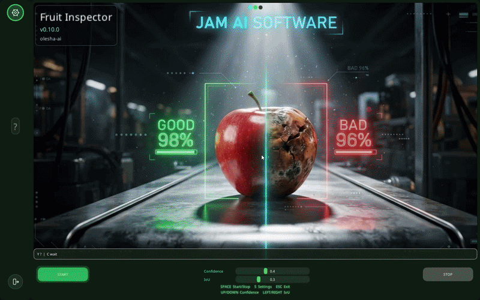
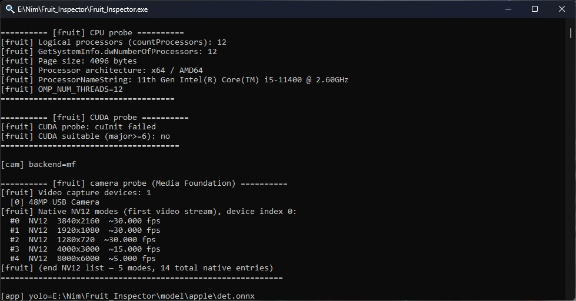
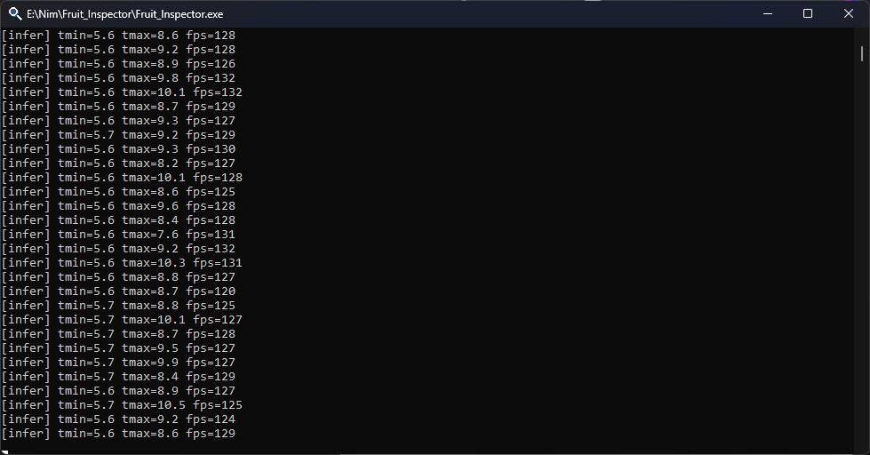

# Fruit Inspector

**build 0.10.0** · Windows x64 · Nim · ONNX Runtime (CPU) · conveyor station demo (eval)

Fruit Inspector is **conveyor inspection**: fruit on a belt; quality is graded only in the **control zone** (centre cell **C**), not anywhere in the frame.

- **This repo:** runnable **Windows demo** (ImGui shell + DLLs). No Nim product source on `main`.
- **Same three inference DLLs for your own UI:** [fruit-inspector-engine](https://github.com/olesha-ai/fruit-inspector-engine) · hookup: [HOST.md](https://github.com/olesha-ai/fruit-inspector-engine/blob/main/HOST.md)

## Download

| File | Use |
|------|-----|
| **[Fruit_Inspector_DLL.7z](https://github.com/olesha-ai/fruit-inspector-demo/releases/download/0.10.0/Fruit_Inspector_DLL.7z)** | **Current package (0.10.0):** `Fruit_Inspector.exe` + `fruit_infer.dll` + `fruit_cat.dll` + `fruit_features.dll` + ORT + models. **Download this.** |
| [Fruit_Inspector.7z](https://github.com/olesha-ai/fruit-inspector-demo/releases/download/0.10.0/Fruit_Inspector.7z) | Older archive on the same release; **not** the full three-DLL layout. Kept for reference only. |

Release page: [0.10.0](https://github.com/olesha-ai/fruit-inspector-demo/releases/tag/0.10.0)

Unpack with [7-Zip](https://www.7-zip.org/) (or similar). Use a local folder, not a network drive.

---

## What is on `main` (this repo)

- [README.md](README.md), [LICENSE.md](LICENSE.md), [licenses/](licenses/)
- Demo media: `infer.gif`, `processor.jpg`, `speed.jpg`
- Binaries only under **[Releases](https://github.com/olesha-ai/fruit-inspector-demo/releases)** — not committed to `main`

## What is inside `Fruit_Inspector_DLL.7z`

- `Fruit_Inspector.exe` — UI, 3×3 grid, conveyor focus/sticky, Windows camera (**NV12** capture path)
- `fruit_infer.dll`, `fruit_cat.dll`, `fruit_features.dll` — all ONNX Runtime inference; the exe is a **shell** (no in-process ORT fallback)
- `lib/cpu/onnxruntime.dll`
- `model/apple/` — `det.onnx`, `cat.onnx`, `features.json` (**apple pack only**)
- `settings.json`, `licenses/` (ship the whole folder)

**Not in the default public archive:**

- `lib/openvino/`, `lib/cuda/` — only if you add them yourself; default build uses **`ort_provider`: `cpu`**
- `trig.exe` — optional LAN helper (see **trig**); not required to run the demo
- Pan-tilt / neck — disabled in this product drop (`neck_com_port` 0)

**Not offered here (yet):**

- Linux / ARM demo build
- Sample host app (C#, Lazarus, …) — use the engine repo
- Factory PLC “stop belt → grade” chain — design direction, not shipped
- Other crop packs — apple only unless added later

---

## Pictures







**Test bench:** Intel **i5-11400**, 32 GB RAM, **no discrete GPU**, USB camera 1920×1080.

**Speed (measured on that bench, CPU EP):**  
With **dual YOLO** (640 full frame + **256 ROI refine**) and the **full loop** (preprocess + ORT + postprocess), the console infer loop is about **~115 fps** — lower than with only the main detect path; the second model and extra pre/post cost time.  
Live camera preview ~**30 fps** (camera limit, not infer).  
`speed.jpg` may reflect an older setup; trust `[infer]` lines when you run from cmd.

---

## Idea

- **3×3 grid**; **C** = control zone
- Up to **two** apples on the line; stable IDs; **focus** on nearest to C; **sticky** after leave C
- **Cat (LightGBM)** only when the focus apple’s centre is **inside C**
- Pipeline: **YOLOX** 640 → ROI **256** → **44 features** → Cat → GOOD / BAD on screen

---

## Station behaviour

- No full-frame chase — work in C with an ID queue
- Approaching C: detect and track only
- In C: features and verdict
- Left C: sticky handoff to the next ID

---

## Architecture (0.10.0)

```
Camera (NV12) → Fruit_Inspector.exe (UI + conveyor logic)
                      ↓
              fruit_infer.dll (YOLO)
                      ↓
              crop RGB on host
                      ↓
              fruit_features.dll → fruit_cat.dll
```

---

## trig

Optional **LAN client** for GOOD/BAD over TCP from the inspector.  
**Not implemented:** full line story (stop section → “ready” → grade). On the desk, Cat runs on **enter C**.

---

## Stack

- Nim, ImGui (GLFW), Windows Media Foundation → NV12
- ONNX Runtime **CPU** in `Fruit_Inspector_DLL.7z`
- `settings.json`: `ort_provider`, models, camera, threads — edit by hand or **Settings → Apply** in the UI

---

## Run

1. Download **[Fruit_Inspector_DLL.7z](https://github.com/olesha-ai/fruit-inspector-demo/releases/download/0.10.0/Fruit_Inspector_DLL.7z)** and unpack.
2. Keep in one tree: exe, three DLLs, `lib/cpu/`, `model/apple/`, `settings.json`, `licenses/`.
3. Set `camera_index` and `ort_provider` (`cpu` first).
4. From cmd: run `Fruit_Inspector.exe` to see `[infer]` fps on stdout.
5. In the UI: **START** / **STOP**; Esc confirms quit.

---

## License

Testing, teaching, research, and feedback — yes.  
Commercial production under this license — no.

Full text: [LICENSE.md](LICENSE.md), [licenses/Fruit_Inspector_LICENSE.md](licenses/Fruit_Inspector_LICENSE.md), [licenses/THIRD_PARTY.md](licenses/THIRD_PARTY.md). Keep `licenses/` next to the exe.

Commercial inquiries: **olesha-ai**.

Intel, OpenVINO, Microsoft, Megvii, and other names are trademarks of their respective owners.

---

olesha-ai
